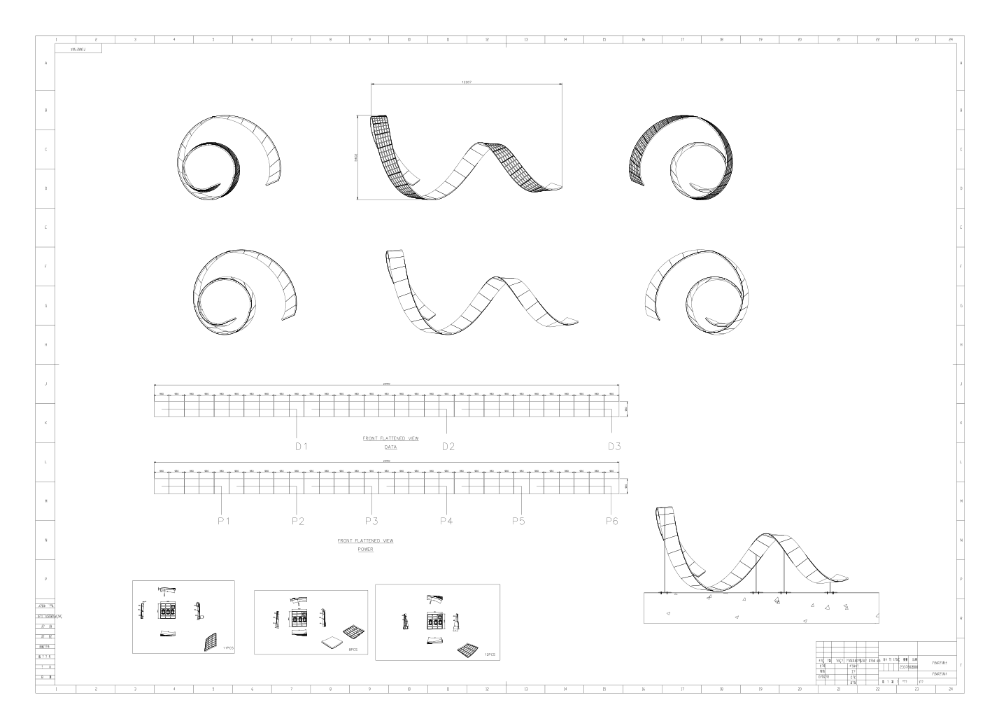

# LED Ёлка — Профессиональная 3D Интерактивная Визуализация и CAD-Конструктив

Интерактивный цифровой 3D-двойник уличной спиральной светодиодной ёлки на гибких модулях **P4-N (320×160 мм)** с магнитным креплением к стальным направляющим полосам каркаса Ст3.



---

## 🌟 Ключевые возможности

1. **Интерактивный CAD-Конфигуратор в реальном времени:**
   * Ползунок **глубины несущего короба** ($90–180\text{ мм}$, базово $130\text{ мм}$) с динамическим индикатором конвекционного зазора охлаждения.
   * Ползунок **высоты ёлки** ($2.5–5.0\text{ м}$, базово $4.0\text{ м}$).
   * Ползунок **числа витков спирали** ($3.0–7.0$, базово $5.2$).
   * Ползунки диаметра основания и вершины с автоматической проверкой радиуса изгиба $R_{min} \ge 200\text{ мм}$.
   * Кнопка моментального сброса к базовым паспортым габаритам.

2. **4 режима отображения и управления слоями каркаса:**
   * **`🎄 В сборе`** — цельный экран с бегущей строкой и анимацией.
   * **`🔮 Рентген (X-Ray)`** — полупрозрачный короб (opacity 25%), насквозь видна вся внутренняя компоновка (БП, карты NovaStar, кабели CAT6, полосы Ст3).
   * **`⚙️ Чистый каркас`** — сняты светодиодные модули, виден несущий силовой металлокаркас, стальные направляющие полосы и силовая мачта.
   * **`⚡ Только электрика`** — обшивка скрыта, в пространстве парят блоки питания, карты NovaStar, трассы витой пары и магниты.

3. **Адаптивная расстановка электрооборудования:**
   * **Блоки питания 5V 40A (P10):** динамический расчёт $N_{psu} = \lceil N_{mod} / 6 \rceil$ и равномерное распределение по длине спирали с вертикальной ориентацией в швеллере.
   * **Принимающие карты NovaStar MRV416-N:** расчёт $N_{cards} = \lceil N_{mod} / 24 \rceil$ с каскадным синим сетевым кабелем CAT6 RJ45 между всеми платами.

4. **Магнитные крепления и 3D-Инспектор отдельного модуля:**
   * Переключение между схемами: **4 магнита vs 8 магнитов на модуль** с пересчётом прижимной силы (12 кг vs 24 кг на модуль).
   * Отдельное 3D-модальное окно с увеличенным видом модуля P4-N ($320 \times 160\text{ мм}$): лицевая пиксельная матрица SMD LED, тыльные рёбра деформации, латунные втулки M4, неодимовые ножки 9 мм и стальные полосы Ст3.

5. **Окружение и суточный цикл:**
   * `❄️ День` (дневное студийное освещение)
   * `🌆 Сумерки` (закатный теплый свет)
   * `🌌 Ночь` (темное небо, снегопад и яркое свечение светодиодов)

---

## 🚀 Запуск и Развёртывание

### Локальный запуск
Проект выполнен на чистом HTML5 / CSS3 / JavaScript (ES6 Modules) с локальной библиотекой Three.js (без внешних зависимостей и CDN):

```bash
# Python 3
python -m http.server 8080

# Открыть в браузере:
http://localhost:8080/index.html
```

### Развёртывание на GitHub Pages (1 минута)
1. Создать репозиторий на GitHub и отправить файлы:
   ```bash
   git init
   git add .
   git commit -m "Initial commit: LED Spiral Tree 3D CAD Configurator"
   git remote add origin https://github.com/ВАШ_ЛОГИН/РЕПОЗИТОРИЙ.git
   git branch -M main
   git push -u origin main
   ```
2. В репозитории на GitHub перейти в **Settings** -> **Pages**.
3. В разделе **Build and deployment** выбрать Source: `Deploy from a branch`, ветка `main` / `root`.
4. Нажать **Save** — через 30 секунд сайт будет доступен всему миру по адресу:
   `https://ВАШ_ЛОГИН.github.io/РЕПОЗИТОРИЙ/index.html`

### Развёртывание на VPS (Nginx)
Скопировать файлы в папку веб-сервера (например, `/var/www/elka/`):
```nginx
server {
    listen 80;
    server_name your-domain.ru;
    root /var/www/elka;
    index index.html;
}
```
